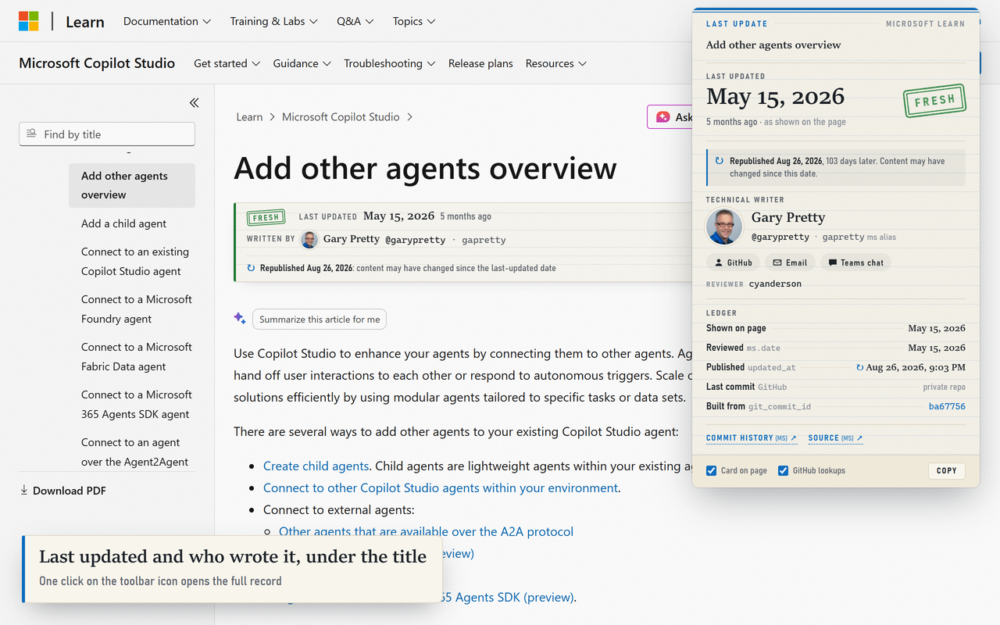

# Learn Last Update

A Microsoft Edge extension that shows when the Microsoft Learn article you're reading was last updated, and who the technical writer is.

- **On the page:** a small card under the article title with a freshness stamp (Fresh, Aging or Stale), the last-updated date, the writer (GitHub name and avatar) and a link to the article's commit history. It follows Learn's light, dark and high-contrast themes.
- **Toolbar badge:** the article's age (`5mo`, `2y`, ...), green up to 6 months, amber up to 12 months and orange after that. Hover over it to see the date and the writer.
- **Popup:** every date Learn publishes (last updated, `ms.date` and `updated_at`), the latest GitHub commit, the writer's GitHub profile and Microsoft alias with **Email** and **Teams chat** shortcuts, the manager, the reviewer and the source links. **Copy** puts a one-line summary on the clipboard.
- **Republished hint:** when Learn published the page more than 14 days after its last-updated date, you see *↻ Republished {date}*. Writers only change `ms.date` for substantial edits, so smaller changes can go live without a new date.

It works on articles, training modules, reference pages and hub pages on `learn.microsoft.com` and `review.learn.microsoft.com`, in every language.

## Install in Microsoft Edge

Installing takes about two minutes. You need Microsoft Edge on Windows or macOS.

### Step 1: Download the extension

1. Open the [Learn Last Update releases](https://github.com/alexusa75/VibeCoding/releases?q=learn-last-update&expanded=true). The newest release is at the top.
2. Under **Assets**, click **learn-last-update-*version*.zip** to download it.
3. In File Explorer, right-click the zip, choose **Extract All...**, pick a folder you'll keep (for example `Documents\Edge Extensions\Learn Last Update`) and click **Extract**. On a Mac, double-click the zip and move the new folder somewhere permanent.

> [!IMPORTANT]
> Keep this folder where it is. Edge loads the extension from it every time it starts, so deleting or moving the folder breaks the extension.

The folder you select in the next step must contain `manifest.json` directly, next to the `icons`, `popup` and `src` folders.

Alternative: get the files from the repository

Clone the repository with `git clone https://github.com/alexusa75/VibeCoding.git`, or click **Code** > **Download ZIP** on the [repository page](https://github.com/alexusa75/VibeCoding) and extract it. Then use the `LearnLastUpdate-EdgeExtension` folder inside it.

### Step 2: Load it in Edge

1. Type `edge://extensions` in the address bar and press **Enter**. You can also select **Settings and more** (**...**) > **Extensions** > **Manage extensions**.
2. Turn on the **Developer mode** toggle in the left pane.
3. Click **Load unpacked**. The button appears at the top of the page once Developer mode is on.
4. Select the folder from Step 1 and click **Select Folder**.

**Learn Last Update** now appears in the list under **From other sources**.

### Step 3: Enable and pin it

1. On the **Learn Last Update** card, make sure the toggle is **on** (blue). It's on right after loading, and it's where you switch the extension off and on later.
2. Pin the icon so you can see the age badge: click **Extensions** (the puzzle-piece icon to the right of the address bar), then click **Show in toolbar** (the eye icon) next to **Learn Last Update**.
3. Optional: to use it in InPrivate windows, click **Details** on the card and turn on **Allow in InPrivate**.

### Step 4: Check that it works

1. Open a Learn article, for example [Add other agents overview](https://learn.microsoft.com/en-us/microsoft-copilot-studio/authoring-add-other-agents). Refresh any Learn tabs that were already open before you installed.
2. A card with the last-updated date and the writer appears under the title, and the toolbar icon shows the article's age.
3. Click the icon to open the details popup.

## Settings

The switches at the bottom of the popup apply to every page:

| Setting | What it does |
| --- | --- |
| **Card on page** | Shows or hides the card under article titles. The badge and the popup keep working when it's off. |
| **GitHub lookups** | Gets the writer's display name and avatar, and the article's latest commit, from GitHub. Turn it off to stop all requests to GitHub. The card then shows the writer's GitHub handle and initials. |

Click **×** on a card to hide it on that page until you close the tab. To bring it back sooner, turn **Card on page** off and on again in the popup.

## Update to a new version

1. Download the new zip from the [releases page](https://github.com/alexusa75/VibeCoding/releases?q=learn-last-update&expanded=true).
2. Extract it into the **same folder** as before and replace the existing files.
3. In `edge://extensions`, click **Reload** on the **Learn Last Update** card, then refresh your Learn tabs.

Your settings are kept as long as you use the same folder. Extensions loaded this way don't update themselves; for automatic updates, see [Share with your team](#share-with-your-team).

## Turn it off or remove it

- **Turn off:** switch its toggle off in `edge://extensions`. Turn it back on the same way.
- **Remove:** click **Remove** on its card in `edge://extensions`. You can then delete the folder.

## Troubleshooting

| Problem | Fix |
| --- | --- |
| There's no **Load unpacked** button. | Turn on **Developer mode** in `edge://extensions`. |
| Edge says "Manifest file is missing or unreadable". | You selected the wrong folder. Select the one that contains `manifest.json`; after **Extract All** it can be one level deeper. |
| **Developer mode** is greyed out or says it's managed by your organization. | Your organization's policy blocks extensions loaded this way. Install it from the Edge Add-ons store once it's published there, or ask your IT admin. |
| Edge asks you to turn off extensions in developer mode. | Close the message without choosing **Turn off**. If the extension was switched off, turn its toggle back on in `edge://extensions`. |
| There's no card on the page. | Refresh the tab. The card appears only on content pages, not on Learn's search, profile or browse pages. Check that the extension is on and that **Card on page** is on in the popup. |
| The writer shows as a GitHub handle without a photo. | **GitHub lookups** is off, or GitHub's limit of 60 anonymous requests per hour was reached (the popup then shows "rate-limited until ..."). It recovers on its own, and results are cached to keep requests low. |
| An **Errors** button appears on the extension's card. | Click it to see the details, then click **Reload** on the card. Report the message if it keeps happening. |

## Share with your team

- **Send them this page (works today).** Teammates follow the steps in [Install in Microsoft Edge](#install-in-microsoft-edge). They download the zip again for each new version.
- **Publish to the Edge Add-ons store (automatic updates).** A *hidden* listing can be installed in one click by anyone with the link, and Edge keeps it up to date. [store/LISTING.md](store/LISTING.md) has the step-by-step Partner Center guide and the text for every field, and the images are in [store/](store/). An IT admin can also install the store version for a group through Intune or Group Policy.

## Privacy

The extension runs only on `learn.microsoft.com` and `review.learn.microsoft.com`, where it reads the article's published metadata. Its only other requests go to GitHub's public API and avatar service, without a token, and **GitHub lookups** turns them off. It doesn't collect or send anything about you or your browsing. See the full [privacy policy](store/PRIVACY.md).

## Where the data comes from

| Shown as | Source on the page |
| --- | --- |
| Last updated | Learn's own "Last updated on" date (`<local-time data-article-date-source>`), else `ms.date`, else `updated_at` |
| Reviewed | `<meta name="ms.date">` |
| Published | `<meta name="updated_at">`, stamped on every publish, even when `ms.date` isn't changed |
| Writer | `<meta name="author">` (GitHub) and `<meta name="ms.author">` (Microsoft alias) |
| Manager / Reviewer | `<meta name="manager">`, `<meta name="ms.reviewer">` |
| Source / history | `github_feedback_content_git_url` (public) and `original_content_git_url` (private `-pr` repo) |

The writer's display name and the latest commit come from the public GitHub API (no token), and the avatar comes from `github.com`. Results are cached (names for 7 days, commits for 6 hours) to stay well under GitHub's anonymous limit of 60 requests per hour.

## For maintainers

- **Try a change:** edit the files, click **Reload** on the extension card in `edge://extensions`, and refresh the Learn tab.
- **Test:** `pip install playwright`, then run `python tests/test_e2e.py` (60 checks) and `python tests/test_navigation.py` (5 checks). They load the extension into Microsoft Edge with Playwright and use live Learn pages, so they need Edge and an internet connection. Screenshots go to `tests/output/`.
- **Publish:** `.\tools\publish.ps1 -Message "What changed" -Test` runs the tests, builds the zip, copies this folder into a clone of [alexusa75/VibeCoding](https://github.com/alexusa75/VibeCoding) (by default `%USERPROFILE%\source\repos\VibeCoding`), commits and pushes, and attaches the zip to the `learn-last-update-v<version>` release. Bump `version` in `manifest.json` for each release teammates should install.
- **Package only:** `python tools/package.py` validates the manifest and builds `store/learn-last-update-<version>.zip` with the runtime files only.
- **Store images:** `python tools/make_store_assets.py` regenerates the logo, promo tiles and screenshots (needs Playwright, Pillow and Edge).
- **Icons:** `python tools/make_icons.py` regenerates `icons/` (needs Pillow).

### Files

- `manifest.json`: Manifest V3.
- `src/core.js`: metadata extraction and date and freshness helpers, shared by all parts.
- `src/content.js`, `src/card-styles.js`: the card on the page.
- `src/background.js`: the toolbar badge and cached GitHub lookups.
- `popup/`: the popup.
- `tests/`: end-to-end tests.
- `tools/`: packaging, publishing, store images and icons.
- `store/`: Edge Add-ons listing guide, privacy policy and images (not part of the extension package).
